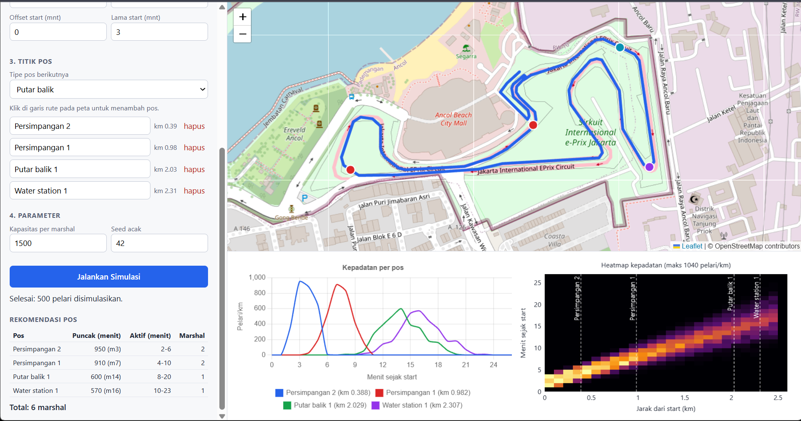

# Marshal Sim

Simulator penempatan marshal untuk event lari. Upload rute GPX, isi data peserta, tandai titik pos di peta, lalu simulasi menghitung kepadatan pelari di tiap titik dan merekomendasikan jumlah marshal serta jam aktif tiap pos.



## Kenapa dibuat

Penempatan marshal di event lari sering didasarkan pada pengalaman dan perkiraan kasar. Padahal kepadatan pelari berubah sepanjang rute dan waktu: persimpangan dan putar balik butuh lebih banyak orang saat pelari menumpuk, sementara ruas yang sepi bisa kelebihan relawan. Idenya datang dari pengalaman jadi marshal volunteer di event lari.

## Fitur

- Upload rute GPX dan tampilkan di peta (Leaflet)
- Klik di garis rute untuk menambah pos: persimpangan, putar balik, water station, atau ruas lurus
- Simulasi kepadatan pelari per titik rute, per menit
- Rekomendasi jumlah marshal dan jam aktif tiap pos
- Grafik kepadatan per pos dan heatmap seluruh rute

## Contoh hasil

Skenario pada screenshot di atas: run leg Jakarta Triathlon (13 September 2026, rute digambar dari peta panitia, dipakai hanya sebagai contoh), 500 pelari, pace 6 ± 1 menit/km, start tersebar 3 menit, jarak 2,5 km, kapasitas 1.500 per marshal, seed 42.

| Pos | Tipe | Km | Puncak (pelari/km) | Menit puncak | Aktif (menit) | Marshal |
| --- | --- | --- | --- | --- | --- | --- |
| Persimpangan 2 | persimpangan | 0,39 | 950 | 3 | 2-6 | 2 |
| Persimpangan 1 | persimpangan | 0,98 | 910 | 7 | 4-10 | 2 |
| Putar balik 1 | putar_balik | 2,03 | 600 | 14 | 8-20 | 1 |
| Water station 1 | water_station | 2,31 | 570 | 16 | 10-23 | 1 |

Total: 6 marshal. Gelombang pelari bergerak sepanjang rute dan makin melebar seiring jarak, jadi pos yang dekat start paling padat tapi aktifnya paling singkat, sedangkan pos di ujung rute lebih sepi tapi aktif lebih lama.

## Cara kerja

Modelnya kinematik sederhana. Tiap pelari punya pace (diambil dari distribusi normal) dan waktu start acak dalam rentang tertentu. Posisinya pada menit ke-t:

```
posisi_i(t) = (t - start_i) / pace_i      (km, dibatasi 0 sampai jarak lomba)
```

Rute dibagi menjadi bin 100 m. Kepadatan = jumlah pelari di bin dibagi lebar bin (pelari/km), dihitung tiap menit. Rekomendasi per pos:

```
skor    = kepadatan puncak x bobot tipe pos
marshal = ceil(skor / kapasitas per marshal), minimal 1 jika ada pelari yang lewat
aktif   = dari pelari pertama sampai pelari terakhir lewat
```

Bobot tipe pos (persimpangan 3, putar balik 2, water station 2, ruas lurus 1) ada di `src/marshal_sim/points.py`. Kapasitas per marshal bisa diubah di UI.

## Menjalankan

Butuh Python 3.11 atau lebih baru.

```cmd
git clone https://github.com/DdullBedull/marshal-sim.git
cd marshal-sim
python -m venv .venv
.venv\Scripts\activate
pip install -e .
uvicorn marshal_sim.api:app --reload
```

Di macOS/Linux, aktifkan venv dengan `source .venv/bin/activate`. Lalu buka http://127.0.0.1:8000 dan upload `data/sample.gpx` (rute dummy berbentuk kotak sekitar 4 km) untuk mencoba.

Skrip demo tanpa web (grafik tersimpan ke folder `output`):

```cmd
python scripts\demo_posts.py
python scripts\demo_viz.py
```

## API

`POST /api/simulate` menerima `multipart/form-data` dengan dua field: `gpx` (file GPX) dan `config` (string JSON). Dokumentasi interaktif ada di http://127.0.0.1:8000/docs.

```json
{
  "categories": [
    {"name": "4K", "distance_km": 4.0, "count": 1000, "pace_mean": 6.0, "pace_std": 1.0, "start_spread_min": 3.0}
  ],
  "points": [
    {"name": "Persimpangan A", "km": 1.0, "type": "persimpangan"}
  ],
  "capacity": 1500,
  "seed": 42
}
```

Respons berisi rute, grid kepadatan, tabel rekomendasi, dan `total_marshal`.

## Tes

```cmd
pip install pytest httpx
pytest
```

17 tes mencakup parser GPX, simulasi, rekomendasi, dan API.

## Struktur

```
src/marshal_sim/
  route.py       baca GPX, hitung jarak kumulatif
  runners.py     generator pelari (pace dan waktu start)
  simulate.py    simulasi kepadatan per titik dan menit
  points.py      tipe pos dan bobotnya
  recommend.py   rekomendasi marshal per pos
  viz.py         grafik dan heatmap (matplotlib)
  schemas.py     validasi input API
  api.py         FastAPI
  static/        halaman web (HTML, CSS, JS)
scripts/         skrip demo
tests/           tes otomatis
data/            file GPX contoh
docs/            screenshot untuk README
output/          hasil grafik skrip demo
```

## Batasan

- Pelari tidak berinteraksi: tidak ada antrean atau salip-menyalip. Di dekat start dengan mass start, kepadatan jadi tidak realistis (jauh di atas yang mungkin terjadi di jalan).
- Bobot tipe pos dan kapasitas per marshal adalah asumsi awal, belum dikalibrasi atau divalidasi dengan data event nyata.
- Pace minimum dibatasi 3 menit/km, jadi belum cocok untuk rute sepeda.
- Belum mendukung rute multi-lap. Rute pergi-pulang yang jalurnya berimpit hanya dihitung satu arah.
- Parser GPX membaca `<trk>` dan menggabungkan semua segmen jadi satu garis; `<rte>` belum didukung.
- Web UI baru menerima satu kategori peserta per simulasi (engine sudah mendukung banyak).
- Hasilnya alat bantu perencanaan, bukan satu-satunya dasar keputusan keselamatan di event nyata.

## Rencana

- Perbandingan skenario (mass start vs wave start)
- Validasi: bandingkan rekomendasi dengan penempatan marshal sebenarnya di event nyata
- Dukungan rute sepeda, multi-lap, dan GPX multi-segmen
- Ekspor hasil ke PDF dan CSV
- Simulasi agent-based (penyempitan jalan, menyalip)

## Teknologi

Python (numpy, pandas, gpxpy, matplotlib), FastAPI, Leaflet, Chart.js.
